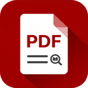

<p align="center">
  
</p>

<h1 align="center">TRK PDF Flow</h1>

<p align="center">
  Ett snabbt PDF-program för Windows: läs, kommentera, stämpla, signera, fyll i, redigera och ordna PDF:er.<br>
  A fast PDF app for Windows: read, comment, stamp, sign, fill in, edit and organize PDFs.
</p>

## Installera / Install

1. Gå till **[Releases](https://github.com/YamYam-ee/trk-pdf-flow/releases/latest)** och ladda ner
   `TRK-PDF-Flow-<version>-x64.msi`.
2. Kör filen. Windows kan visa *"Windows skyddade datorn"* eftersom installern inte är kodsignerad:
   klicka **Mer information → Kör ändå**.
3. Starta **TRK PDF Flow** från Start-menyn eller skrivbordet. Vill du öppna PDF:er med det som
   standard: högerklicka på en PDF → *Öppna med* → *Välj en annan app* → TRK PDF Flow → *Använd alltid*.

## Uppdatera / Update

TRK PDF Flow kollar vid start om det finns en nyare version här på GitHub och säger till i så fall.
Klicka **Ladda ner**, hämta den nya `.msi`-filen och kör den: den ersätter den installerade
versionen, och dina inställningar, signaturer och stämplar ligger kvar. (Kontrollen kan stängas av
under Inställningar.)

## Det här finns / Highlights

- Svenskt gränssnitt (väljs automatiskt när Windows körs på svenska) och 16 andra språk.
- **Signera/stämpla**: färdiga stora stämplar (KLAR, FAKTURERAD, SPÄRRAD, UNDERKÄND …) med datum och
  namn, egna stämplar, sparade signaturer, och snabbknappar för favoritstämpel och favoritsignatur.
- Kommentarer, överstrykningspenna (fri hand, Skift för raka streck), pilar, linjer och pratbubblor,
  även i låsta PDF:er; bara själva innehållet förblir låst.
- **Lås upp** skyddade PDF:er med lösenordet, eller gör en olåst kopia.
- Textigenkänning (OCR) inbyggd, med Windows egen svenska igenkänning eller Google Gemini
  (egen API-nyckel under Inställningar).
- Flikar som kan döpas om och sorteras.

## Om / About

TRK PDF Flow is a modified version of [PdfCraft](https://github.com/storytold/pdfcraft), an
open-source PDF application written in Rust, which is based on work by the ArtCraft team. It is not
made, sponsored or endorsed by the ArtCraft team. Licensed under MIT OR Apache-2.0
([LICENSE-MIT](LICENSE-MIT), [LICENSE-APACHE](LICENSE-APACHE), [NOTICE](NOTICE)); third-party
material is listed in [ATTRIBUTION.md](ATTRIBUTION.md).

### Bygga själv / Building

Rust 1.95 or newer, Windows:

```powershell
cargo build --release -p pdfcraft            # target\release\TRK-PDF-Flow.exe
pwsh packaging/windows/trk-release.ps1       # dist\trk\TRK-PDF-Flow-<version>-x64.msi (needs WiX v5)
```
