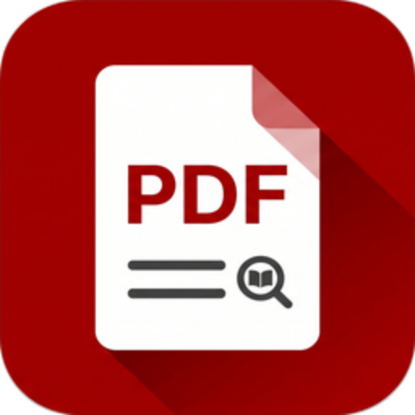

# PdfCraft app icon



A red rounded square (about `#9e0000`) with a white page, a folded corner, red **PDF** lettering,
two text lines and a magnifier over a book, with a long diagonal shadow.

**Provenance:** provided by the owner of this build (generated with Google Gemini). The tile was cut out
of the supplied 2752x1536 image, squared, given a transparent rounded-corner mask and resized to every
size below with Pillow (Lanczos). The SVG files embed the bitmap; there is no traced vector.
Licence: [LICENSE.txt](LICENSE.txt) (`MIT OR Apache-2.0`, like the repo).

## Files

| File | What it is |
|---|---|
| `pdfcraft.svg` | the master vector (traced at 2048 px); every PNG, `.ico` and `.icns` is rendered from it |
| `pdfcraft-small.svg` | a lighter vector (traced at 1024 px) for places where size matters, such as this README |
| `pdfcraft-1024.png` | 1024 px on Apple's grid; also the runtime Dock icon on macOS |
| `pdfcraft.icns` | macOS icon (16–1024 px) |
| `pdfcraft.ico` | Windows icon (16–256 px), embedded in `pdfcraft.exe` by `apps/pdfcraft/build.rs` |
| `pdfcraft-document.svg` | Windows PDF file icon (the same artwork as the app icon) |
| `pdfcraft-document.ico` | Windows PDF file icon (16–256 px), embedded as resource 2 in `pdfcraft.exe` |
| `hicolor/<n>x<n>/apps/ai.storyteller.pdfcraft.png` | Linux hicolor theme, 16–512 px; the 256 px one is the runtime icon on Windows and Linux |
| `hicolor/scalable/apps/ai.storyteller.pdfcraft.svg` | Linux scalable icon (copy of the master) |

Where it shows: `apps/pdfcraft/src/main.rs` sets the window icon (Dock, taskbar, Alt-Tab, launcher) and the
Wayland app id `ai.storyteller.pdfcraft`; `packaging/linux/ai.storyteller.pdfcraft.desktop` names the
hicolor icon.

Windows PDF files use resource 2 (`"pdfcraft.exe",-2`) when PdfCraft is chosen as the default
reader; the app keeps resource 1. In this build both resources hold the same artwork. Both icons are embedded, requiring no runtime
sidecar. This provides a file type icon; first-page thumbnails still need a thumbnail provider.

## Regenerate

```sh
packaging/icons.sh        # needs resvg and python3; iconutil (macOS) for the .icns
cargo xtask assets        # then update the sha256 values in ATTRIBUTION.toml and run with --write
```
